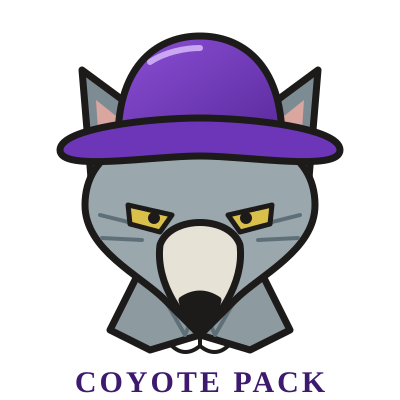

<p align="center">
  
</p>

<h1 align="center">Coyote Pack</h1>

<p align="center"><i>Lavender Hill never had a coyote. Until now.</i></p>

A browser game about a gray urban coyote who crosses a bridge into Lavender Hill, a hilly, Queen Anne–style neighborhood, just as the bridge lifts behind them. Scavenge, hunt, befriend other coyotes, form a roving pack, take over the farmers' market, and try not to annoy the neighborhood enough to bring in the Feds.

Built with vanilla JavaScript (a small custom pseudo-3D Canvas renderer, no libraries) and a small PHP backend for accounts, cloud saves and optional AI-written animal dialogue. Works on desktop and mobile browsers.

By [Daniel McKeown](https://altaredwood.work).

## Features

- **Lavender Hill**: old houses and modernist boxes, a main commercial strip (groceries, coffee shops, froyo, hardware, a clinic…), parks with a creek, blackberry-covered pine woods, a beach with sea lions.
- **Survive and grow**: hunt rabbits, geese, possums (and, in a pack, deer); rip open dropped grocery bags; tip bins; drink from creeks and puddles. Eating earns XP and levels.
- **Coyote friends and packs**: learn each coyote's body language to befriend it. Packs hold up to four, last a few minutes, and last longer the more you eat and evade the cops. Old friends answer your howl.
- **Events**: a Farmer's Market (overwhelm it with a pack), picnics in the park, grocery doors that slide open on a timer, coffee shops full of very jittery coffee.
- **Characters to meet**: crows who trade scouting flights, cats, foxes, dogs on leashes, sea lions (don't), a friendly wizard (treats), a witch (10-second flight spells) and a jack-o-lantern monster with legs.
- **World systems**: a 3-minute day/night cycle with seasons and moon phases, rain about a fifth of the time, sleeping (5 hours, sped up), police and, after prolonged trouble, a federal helicopter.
- **Generative ambient soundtrack**, barks, group howls and a mute button.
- **Pause with screenshot** (with credit and timestamp), a Settings screen (Stats, Character, Controls, Account, Save, Debug, Credits, Terms, Privacy).
- **Two playable looks**: the original *Classic Trickster* or the more naturalistic *Wild Trotter*.

## Controls

| Input | Action |
| --- | --- |
| Left pad / WASD / arrows | Move (push further, or hold Shift, to run) |
| 🐾 / `J` or `Z` | Interact and socialize; sniff for food |
| 🐺 / `K` or `X` | Act wild: pounce, growl, rip bags, tip bins. Tap to bark, hold to howl |
| 🍖 / `L` or `C` | Eat or drink (hold to keep going) |
| ✔ / `V`, `Enter` or `Space` | Select, and open the action menu (sleep, cast flight, release pack) |
| `Q` / `E`, mouse wheel, drag | Rotate and zoom the camera |
| `Esc` / `M` | Pause / mute |

## Quick start

You need **PHP 8.1 or newer**. No Composer, npm or build step.

```powershell
git clone <this repo> coyote-pack
cd coyote-pack
php -S 127.0.0.1:8080 -t public
```

Then open <http://127.0.0.1:8080/>.

- Serve the **`public/`** folder only. `config.php`, `src/` and `data/` live outside it on purpose so they can't be downloaded.
- If the port is refused (on Windows some ranges are reserved), pick another, e.g. `3917`.
- The game still runs as a plain static site without PHP (open `public/` through any web server). You'll lose accounts, cloud saves and AI dialogue, but local saves and built-in dialogue still work.

## Project layout

```
public/            web root
  index.html, css/, img/logo.svg
  js/              game (ES modules): world, render, rigs, npc, player, game, ui, audio…
  api/index.php    JSON API: status, accounts, saves, dialogue, debug
src/               Storage.php (SQLite / MySQL / JSON files), Ai.php (LLM providers)
config.php         defaults and documentation for every option
config.local.php   your private overrides (git-ignored, you create it)
data/              created at runtime: database / JSON saves (git-ignored)
art/               reference artwork that informed the visual style
```

## Configuration

All options are documented in [`config.php`](config.php). **Don't edit it for secrets.** Create `config.local.php` next to it that returns just the values you want to change; it's merged over the defaults:

```php
<?php
return [
    'storage' => ['driver' => 'mysql', 'mysql' => ['user' => 'coyote', 'password' => '…', 'database' => 'coyote_pack']],
    'ai'      => ['provider' => 'openai', 'openai' => ['model' => 'gpt-4o-mini', 'key' => '…']],
];
```

### Data storage

Accounts and saves are stored by one of three drivers, chosen with `storage.driver`:

| Driver | When it's used | Notes |
| --- | --- | --- |
| `auto` (default) | MySQL if `mysql.user` is set, else SQLite if the `pdo_sqlite` extension exists, else JSON files | |
| `sqlite` | A single file at `data/coyote.sqlite` | Needs `pdo_sqlite` |
| `mysql` | MySQL / MariaDB | Needs `pdo_mysql`. Create an empty database; tables are created automatically |
| `json` | Flat files in `data/json/` | No extensions needed; fine for small/local use |

If a requested driver fails, the game falls back to JSON files and says so in **Settings → Debug**, which also shows the active persistence type, PHP extensions and AI configuration.

Guests can always save to their browser (`localStorage`). Logged-in players can save to the server too.

## AI-written animal dialogue (optional)

Animals and characters speak in a dialogue box. Out of the box, they use built-in lines. If an AI provider is available, the backend asks it for a short in-character reply and **falls back to the built-in lines** on any failure or timeout, so the game never depends on it. After a failure, AI calls pause for `backoff_seconds` (default 45) so a missing server doesn't slow the game.

Only a speaker name, a topic and coarse game state (time of day, weather, level, pack size) are sent. No account names, no IP addresses.

### Local Ollama (default)

1. Install [Ollama](https://ollama.com) and pull a small model:
   ```
   ollama pull llama3.2
   ```
2. Make sure it's running (it listens on `http://localhost:11434`).
3. Start the game. That's it: `ai.provider` is `ollama` with model `llama3.2` by default. Change `ai.ollama.model` / `ai.ollama.url` in `config.local.php` for another model or machine.

### Cloud providers

Set `ai.provider` and fill in that provider's section. Keys can be set in `config.local.php` or via environment variables.

| `provider` | Config section | Environment variable |
| --- | --- | --- |
| `openai` | `ai.openai` (`url`, `model`, `key`) | `OPENAI_API_KEY` |
| `anthropic` | `ai.anthropic` | `ANTHROPIC_API_KEY` |
| `gemini` | `ai.gemini` | `GEMINI_API_KEY` |

The `openai` provider speaks the OpenAI chat-completions format, so it also works with **OpenAI-compatible** services such as Groq, OpenRouter, Together, Mistral or LM Studio: just change `url` and `model`.

```php
// config.local.php: example using Groq
return ['ai' => ['provider' => 'openai', 'openai' => [
    'url' => 'https://api.groq.com/openai/v1', 'model' => 'llama-3.1-8b-instant', 'key' => getenv('GROQ_API_KEY'),
]]];
```

Set `'enabled' => false` to turn AI off completely. Use **Settings → Debug → Test AI dialogue** to check that it's responding.

> HTTPS providers need PHP's `curl` or `openssl` extension. Without either, only plain-HTTP endpoints (like local Ollama) work.

## Deploying

1. Upload the project to a host with PHP 8.1+ and point the web server's document root at **`public/`**.
2. Make `data/` writable by the PHP user (it's created automatically if the project folder is writable). It's outside the web root, so it isn't served.
3. Serve over **HTTPS**. The session cookie is marked `Secure` automatically when the request is HTTPS.
4. Add a `config.local.php` for your database and/or AI provider (keep API keys out of version control).
5. Optional: use MySQL/MariaDB for multi-instance hosting. SQLite and JSON files are fine for a single server.

Example nginx snippet:

```nginx
root /var/www/coyote-pack/public;
index index.html;
location ~ \.php$ { include fastcgi_params; fastcgi_pass unix:/run/php/php-fpm.sock; fastcgi_param SCRIPT_FILENAME $document_root$fastcgi_script_name; }
```

### Security notes

- Passwords are stored with PHP's `password_hash`; logins are throttled and locked after repeated failures.
- State-changing API calls need a per-session CSRF token; the session cookie is HttpOnly and SameSite=Strict.
- Save data is size-limited (64 KB) and validated; the AI endpoint is rate-limited and only accepts whitelisted speakers and topics. The client never chooses the AI URL.
- The in-game Terms and Privacy tabs are written for a hobby deployment. Review and adapt them (operator name, contact, retention) if you host it publicly.

## Troubleshooting

- **Blank page or module errors:** you must serve over HTTP (`php -S …`); opening `index.html` as a `file://` URL won't load the ES modules.
- **Slow on a phone or old laptop:** Settings → Controls → Quality → *Low*, and bring the camera closer.
- **AI dialogue never appears:** check Settings → Debug. For Ollama, confirm `ollama serve` is running and the model name matches `config.php`.
- **"Failed to listen … forbidden" on Windows:** choose a different port.

## Credits

Coyote Pack by [Daniel McKeown](https://altaredwood.work). Visual style inspired by the marker-and-ink drawings in [`art/`](art/). All graphics are drawn and all sound is synthesized live in the browser; there are no third-party assets or libraries.
